<h1 align="center">Hey 👋 I'm Omran Al Zarouni</h1>

  

## 📌 About Me

Networking and Security Engineering student at **Ajman University** (UAE).
I work on Odoo e-commerce and operations systems, using AI-assisted development.

## 📊 GitHub Stats

  

  

  

  <picture>
    <source media="(prefers-color-scheme: dark)" srcset="assets/activity-dark.svg">
    
  </picture>

## 🛠 Languages & Tools

  

## 🚀 Projects

### Zodoo — intelligent auction and barter platform

**2nd place, Odoo Annual Hackathon (November 2026)** · Team GradX · Odoo 19, connected to Odoo Inventory and Website

- **DALLAL, an AI auctioneer.** Announces every bid, price change and closing in a live voice with subtitles (English voice; announcement text in English and Arabic). It only announces bids that were actually committed, and a fault in the announcer can never block bidding.
- **Runs fully local, no external AI API.** Price and sale-probability models (LightGBM), speech-to-text (Whisper) and text-to-speech (Kokoro) all run on the machine's own CPU.
- **Auction terms by voice.** Spoken reserves and limits are turned into settings by a rule-based parser that asks for confirmation when the wording is ambiguous.
- Live auctions and barter offers, a double-entry ledger with simulated money, risk alerts and an insights dashboard.
- Confidential values (reserves, auto-bid maximums) are never shown to other bidders. Automated test suite.

### Retail Odoo 17 modules

80 custom modules on the production branch of a live retail business.

- **Consignment marketplace** — customers sell through the store for a commission: seller app, inspection, payouts, analytics.
- **Cashier close and profit dashboards** — end-of-day reconciliation and profit boards read straight from the books.
- **Inventory and operations** — guided stock counts, technician job pool with PIN identity, 88 automation rules kept under git.
- **Website and payments** — speed and SEO work, structured data, passwordless login, buy-now-pay-later payment provider.

### E-commerce mobile app

Flutter app (Arabic/English) for the store's customers, backed by an Odoo REST API.

- Phone-based sign-in, catalog with category drill-down, product variants, cart and checkout.
- Widget and unit tests.

## 🔗 Connect with Me

[LinkedIn](https://www.linkedin.com/in/omran-al-zarouni-121ab1374)

> Most of my code is in **private repositories**. Send me your GitHub username and I'll add you as a collaborator.
